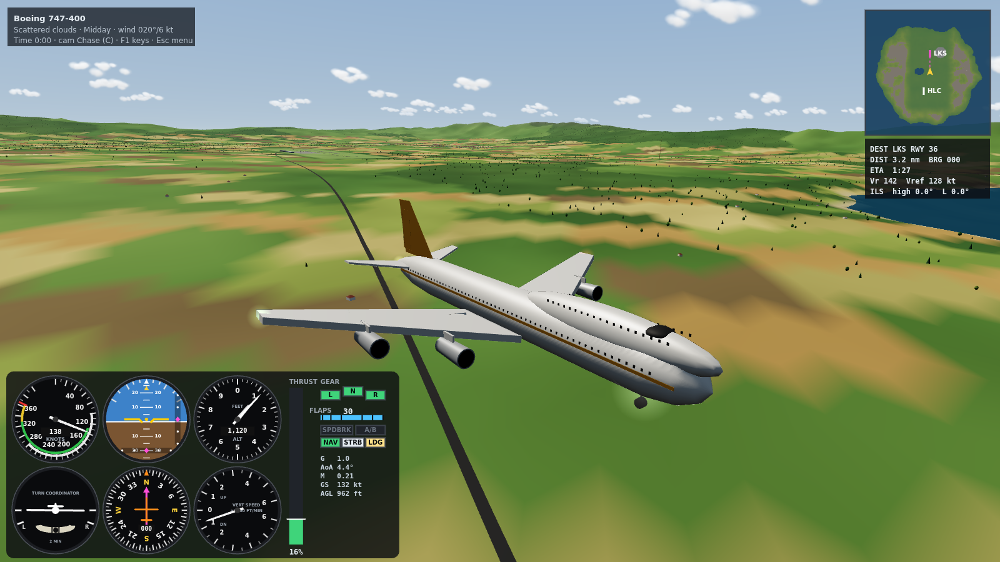

# VibeFlight

A basic browser flight sim (Three.js, single `index.html`, no build step).

**Play:** open `index.html` in a desktop browser (needs internet for the Three.js CDN), or serve the folder with any static server, e.g. `python3 -m http.server 8090` and open http://localhost:8090/.

- 9 jets: F-16C, F/A-18C, A-10C, Learjet 45, Boeing 737-800, Airbus A320neo, Boeing 777-300ER, Boeing 747-400, Airbus A380-800
- Simplified but physical flight model: lift/drag curves, stall, ground effect, thrust lapse, afterburner, G/AoA limits, wheel friction and brakes
- Gear, flaps, speed brake, nav/beacon/strobe/landing lights
- Weather: clear, scattered, overcast, rain, thunderstorm, fog, snow; wind and turbulence; dawn/midday/sunset/night
- Procedural island with hills, mountains, lake, farmland, forests, a city, a town, wind turbines, two airports with runway lights, approach lights and PAPI
- Six-pack instruments (airspeed, attitude + ILS, altimeter, turn coordinator, heading + bearing pointer, vertical speed), systems panel, minimap, cockpit HUD

Mission: take off from Hillcrest (HLC) and land on runway 36 at Lakeside (LKS), 12 km north (~2 min).
Press **F1** in game for the controls.
