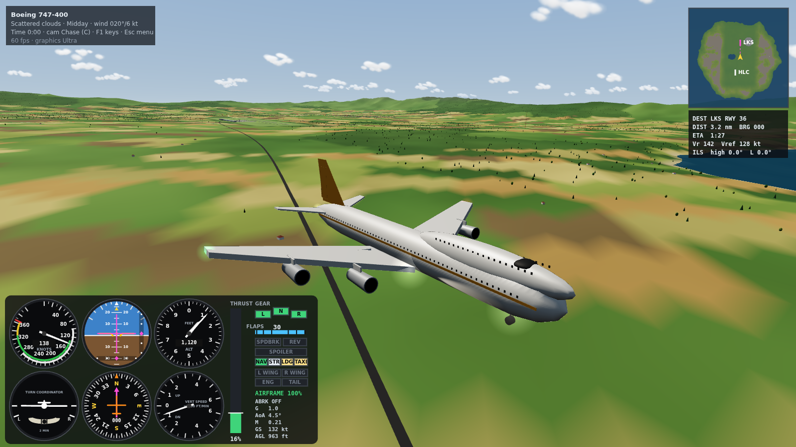
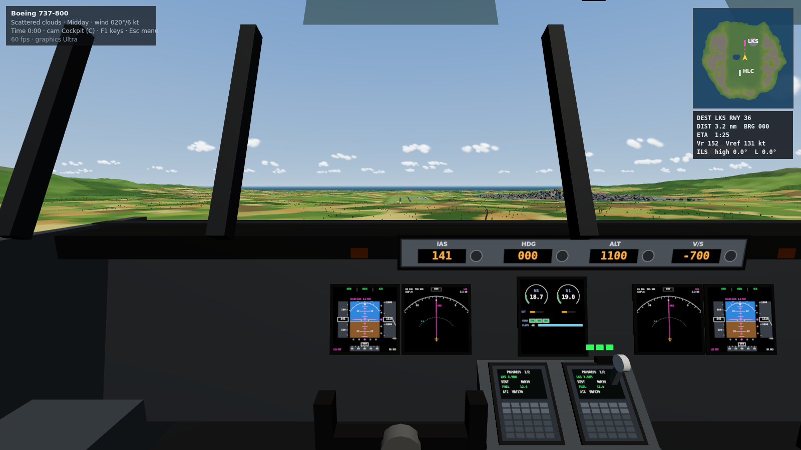
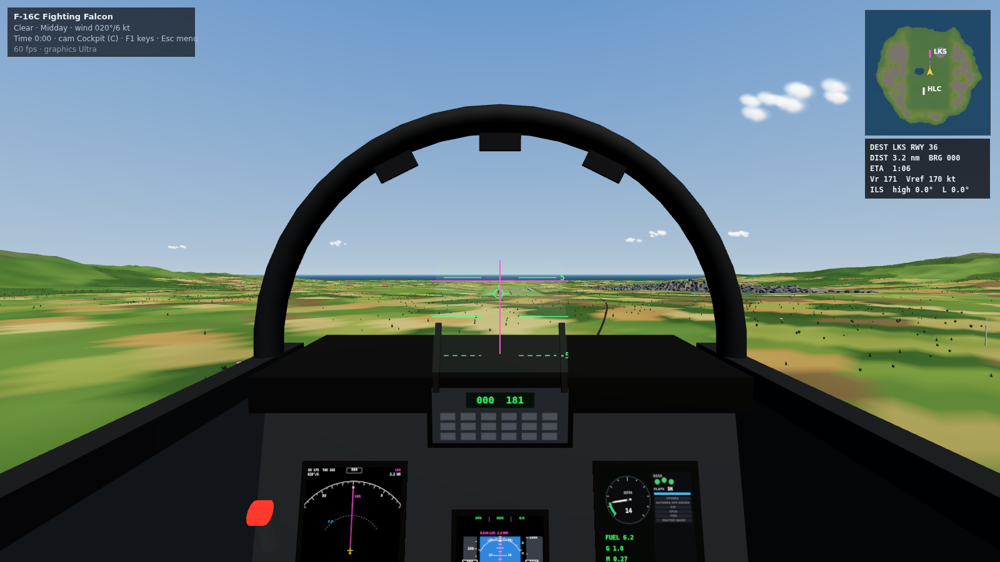
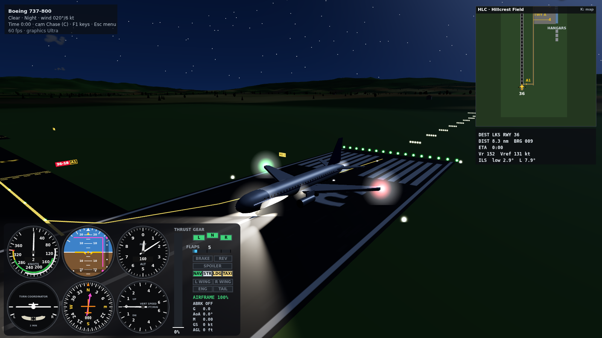
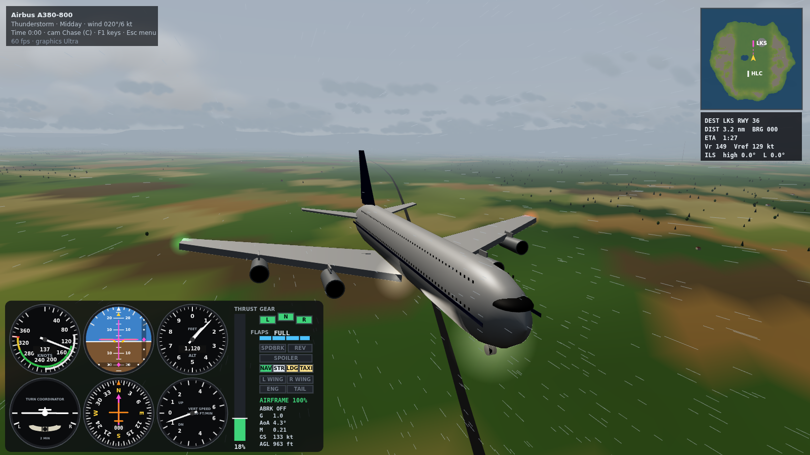
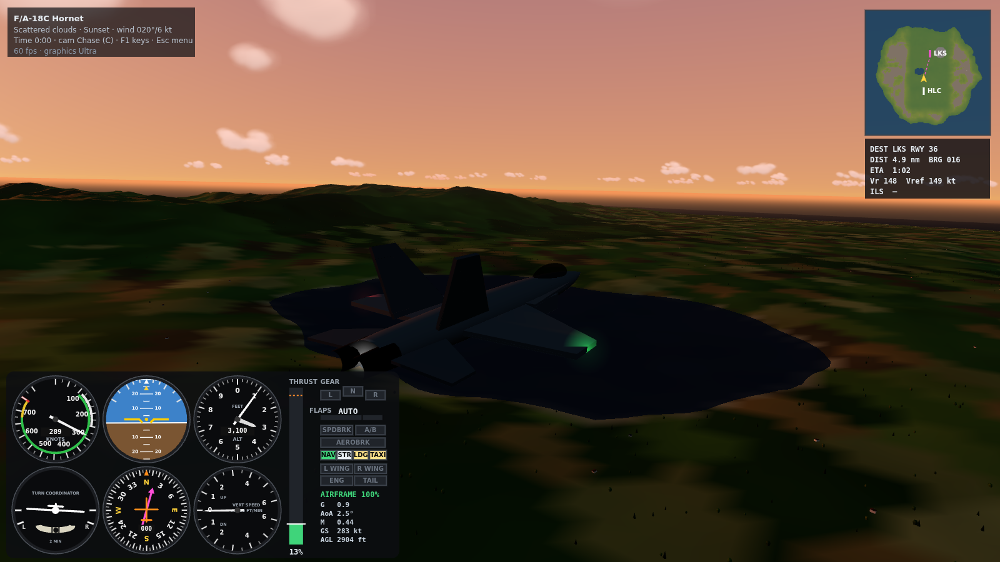
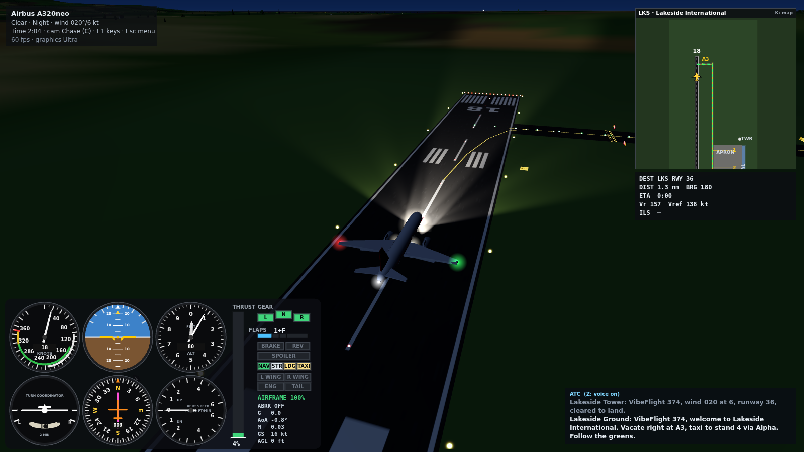

# VibeFlight

A browser flight sim in a single `index.html` (Three.js, no build step). Take off from **Hillcrest (HLC)**, fly about 12 km north, land on runway 36 at **Lakeside International (LKS)** and taxi to your gate in roughly two to three minutes.



| | | |
|---|---|---|
|  |  |  |
| 737 glass cockpit: PFD, ND, EICAS, MCP, CDUs | F-16 cockpit: HUD in the combiner, ILS needles, MFDs | Night: runway, taxiway and approach lights, landing lights |
|  |  |  |
| A380 on approach in a thunderstorm | F/A-18 at sunset over the island | After landing: ATC taxi instructions, airport diagram |

## Play

Open `index.html` in a desktop browser (it needs internet once for the Three.js CDN), or serve the folder:

```bash
python3 -m http.server 8090   # then open http://localhost:8090/
```

Press **F1** in game for the full key list.

## Features

**Aircraft (9)**: F-16C, F/A-18C, A-10C, Learjet 45, Boeing 737-800, Airbus A320neo, Boeing 777-300ER, Boeing 747-400, Airbus A380-800. Each has its own mass, thrust, wing, flap settings and handling, plus derived takeoff (Vr) and approach (Vref) speeds.

**Flight model**
- Lift and drag curves with stall and wing drop, ground effect, wave drag, thrust that falls off with altitude and speed, and afterburner on the fighters.
- G and angle-of-attack limits on the fly-by-wire fighters, weathervane yaw stability, and realistic rotation rates with tail-strike protection.
- Wind with a ground-level profile, turbulence and gusts.

**Systems**
- Landing gear (G), with spring-damper legs that bounce and shake.
- Flaps (V / Shift+V) with speed limits.
- Speed brake and wheel brakes (B), auto ground spoilers, thrust reversers (F at idle) and **autobrake** (X: 1/2/3/MAX, plus RTO for a rejected takeoff).
- Lights: nav, beacon, strobes, wing landing lights (L), taxi and runway turnoff lights (T).

**Damage instead of instant crash**
- Hard landings strain or collapse the gear.
- Wingtip, tail and nose strikes; belly slides with sparks; engines scraping the ground and catching fire.
- Over-g wing damage and flaps jammed by overspeed.
- Ditching in the water.
- Only a violent impact destroys the jet, leaving a burning wreck.

**Cockpits (C)**
- **Airliners:** primary flight display (PFD) and navigation map (ND) for each pilot, engine and alert display (EICAS), autopilot panel (MCP), flight-computer keypads (CDUs), overhead panel. Moving yokes or sidesticks, throttle, reverse, flap and speedbrake levers, rudder pedals, gear lever with lights, and master warning lights.
- **Fighters:** HUD drawn inside the combiner glass, two multi-function displays, keypad panel, stick and throttle grips, ejection-seat handle and canopy mirrors.

**Instruments and navigation**
- The classic six-pack: airspeed, attitude, altimeter, turn coordinator, heading with a bearing pointer, and vertical speed.
- ILS crosshair needles, PAPI lights, a systems/damage panel, island minimap, and an airport diagram on the ground (K).

**ATC (voice + transcript)**
- Calls in order: takeoff clearance, handoff to approach, cleared ILS, cleared to land.
- After landing, ground control gives taxi instructions ("vacate right at A3, taxi to stand 4 via Alpha"), a green-lit route to follow, and a parking check at the stand.
- Z toggles the voice.

**Airports**
- 3 km runway with markings, edge, centerline and threshold lights, approach lights with sequenced flashers, and PAPI.
- Taxiway Alpha with exits A1 to A3: hold-short bars and signs, direction and location signs, runway distance-remaining boards, and green centerline lights.
- Apron with four numbered stands (lead-in lines and stop bars), jet bridges, a named terminal, tower, hangars, floodlights, windsock and parked airliners.

**World and weather**
- Procedural island: hills, snow-capped mountains, a lake, farmland, forests, a city with lit windows at night, a town, road, wind turbines, a radio mast and a lighthouse.
- Weather: clear, scattered, overcast, rain, thunderstorm (with lightning and thunder), fog and snow, plus wind direction and speed. Time of day: dawn, midday, sunset or night.

**Cameras**: chase, cockpit, fly-by and tower, with mouse-drag look-around and zoom.

**Sound**: engine and turbine, afterburner, wind, rain, tyre screech on touchdown, runway rumble, gear motor and clunk, warning tones and thunder.

**Performance**
- Detects the GPU and adjusts graphics automatically (Potato → Ultra): resolution, shadows, view distance, clouds, trees, lights and effects.
- The menu has a manual override, and warns if the browser is drawing without GPU acceleration.

**Other**: gamepad support (press a button to activate), pause, mute, and settings remembered between sessions.

## Developer notes

- `?selftest`: runs scripted physics checks and logs them to the console: takeoffs, landings, autobrake, rejected takeoff, damage, hands-off ground rolls, and the full ATC taxi-to-gate flow.
- `?auto&plane=…&start=…&time=…&weather=…&cam=…&gfx=…`: starts a flight straight away. Used for the screenshots above.
